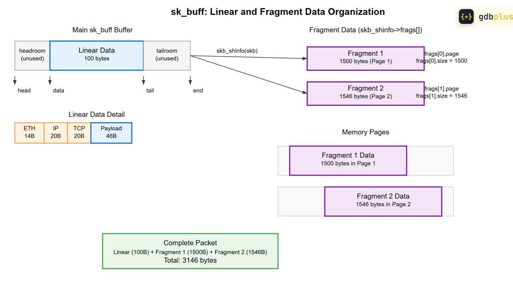

# References
- Heavily from [DIRTY FRAG org repository](https://www.google.com/url?sa=t&source=web&rct=j&opi=89978449&url=https://github.com/v4bel/dirtyfrag&ved=2ahUKEwjL-_ec2OaXAxUcieEIHWNgAFQQFnoECBkQAQ&usg=AOvVaw1XjLam4STGkzUY7apPJEia)

> Incompleted research

# CVE-2026-43284

```c
diff --git a/net/ipv4/esp4.c b/net/ipv4/esp4.c
index 6dfc0bcdef654..6a5febbdbee49 100644
--- a/net/ipv4/esp4.c
+++ b/net/ipv4/esp4.c
```c
@@ -873,7 +873,8 @@ static int esp_input(struct xfrm_state *x, struct sk_buff *skb)
 			nfrags = 1;
 
 			goto skip_cow;
-		} else if (!skb_has_frag_list(skb)) {
+		} else if (!skb_has_frag_list(skb) &&
+			   !skb_has_shared_frag(skb)) {
 			nfrags = skb_shinfo(skb)->nr_frags;
 			nfrags++;
diff --git a/net/ipv4/ip_output.c b/net/ipv4/ip_output.c
index e4790cc7b5c2e..5bcd73cbdb41c 100644
--- a/net/ipv4/ip_output.c
+++ b/net/ipv4/ip_output.c

@@ -1233,6 +1233,8 @@ alloc_new_skb:
 			if (err < 0)
 				goto error;
 			copy = err;
+			if (!(flags & MSG_NO_SHARED_FRAGS))
+				skb_shinfo(skb)->flags |= SKBFL_SHARED_FRAG;
 			wmem_alloc_delta += copy;
 		} else if (!zc) {
 			int i = skb_shinfo(skb)->nr_frags;
diff --git a/net/ipv6/esp6.c b/net/ipv6/esp6.c

index 9f75313734f8c..9c06c5a1419dc 100644
--- a/net/ipv6/esp6.c
+++ b/net/ipv6/esp6.c

@@ -915,7 +915,8 @@ static int esp6_input(struct xfrm_state *x, struct sk_buff *skb)
 			nfrags = 1;
 
 			goto skip_cow;
-		} else if (!skb_has_frag_list(skb)) {
+		} else if (!skb_has_frag_list(skb) &&
+			   !skb_has_shared_frag(skb)) {
 			nfrags = skb_shinfo(skb)->nr_frags;
 			nfrags++;

diff --git a/net/ipv6/ip6_output.c b/net/ipv6/ip6_output.c

index 7e92909ab5be3..1f2a33fbed6e6 100644
--- a/net/ipv6/ip6_output.c
+++ b/net/ipv6/ip6_output.c

@@ -1794,6 +1794,8 @@ alloc_new_skb:
 			if (err < 0)
 				goto error;
 			copy = err;
+			if (!(flags & MSG_NO_SHARED_FRAGS))
+				skb_shinfo(skb)->flags |= SKBFL_SHARED_FRAG;
 			wmem_alloc_delta += copy;
 		} else if (!zc) {
 			int i = skb_shinfo(skb)->nr_frags;
```

The condition is hardened with the presence of `skb_has_shared_frag`. Has the same code patch with `poc`

- ./net/ipv4/esp4.c
- ./net/ipv6/esp6.c
- ./net/ipv4/ip_output.c
- ./net/ipv6/ip6_output.c

# CVE-2026-43500
Has different code with the source of `poc` but remain the same vuln

# Knowledges
## Page cache
Works like RAM, stores temporary memory for efficiency use

## ESP (Encapsulating Security Payload)
> Used to `encrypt` packets' data and `authenticate` network traffic. 

`ESP provides 3 main protections`:
- `Confidentiality (Encryption)`: Encrypts the IP packet's payload using symmetric ciphers (e.g., AES-CBC, ChaCha20, or modern AEAD modes like AES-GCM) so unauthorized parties cannot read the transit data.

- `Data Origin Authentication & Integrity`: Uses a cryptographic checksum (Integrity Check Value / ICV or AEAD auth tag) to verify that the packet came from the genuine sender and was not modified in transit.

- `Anti-Replay Protection`: Tracks monotonically increasing sequence numbers (32-bit standard or 64-bit with `XFRM_STATE_ESN`) with a sliding window to detect and drop `duplicated/replayed` packets.

ESP encapsulates the packet payload by wrapping it with a header and trailer:
```c
+-----------------------+-----------------------------+
| ESP Header            | SPI (32-bit)                |  (Unencrypted)
|                       | Sequence Number (32-bit)    |
+-----------------------+-----------------------------+
| Payload Data          | TCP / UDP / Inner IP ...    |  (Encrypted)
|                       | Padding (0-255 bytes)       |
+-----------------------+-----------------------------+
| ESP Trailer           | Pad Length (8-bit)          |  (Encrypted)
|                       | Next Header (8-bit)         |
+-----------------------+-----------------------------+
| ESP ICV               | Authentication Tag / MAC    |  (Integrity Check) (chính trực check)
+-----------------------+-----------------------------+
```

- `SPI (Security Parameters Index)`: A 32-bit ID used by the `receiver` along with the `destination IP` to look up the `correct` Security Association (SA) in the kernel’s SAD.

- `Sequence Number`: `Incremented` per packet to `prevent` replay attacks.

- `Next Header`: `Identifies` the **protocol** contained in the payload (e.g., 6 for TCP, 17 for UDP, or 4 for an `encapsulated` IPv4 header in `tunnel mode`).

- `ICV (Integrity Check Value)`: Computed over the ESP header, payload, and trailer.

> The vulnerability occurs because a `logical bug` in the Linux kernel's xfrm-ESP implementation (`esp_input()`) permits data to be `decrypted directly` into `read-only` page-cache memory instead of copying it safely first.
## ESN (Extended Sequence Number)
> This is an `extension` to `standard IPsec ESP` that prevents replay attacks on high-speed networks by using a 64-bit sequence number instead of a 32-bit one.

## "Frag" (Fragment / Socket Buffer Fragment)
> This refers to how the Linux kernel handles fragmented socket buffers (sk_buff) when passing memory pages
## NIC
> The Kernel NIC Interface (KNI) is a feature in the `Data Plane Development Kit` (DPDK) that lets user-space programs share network packets with the Linux kernel networking stack.
### XFRM device - offloading the IPsec computations
The XFRM Device interface allows `NIC drivers` to offer to the `stack access` to the `hardware offload`.

### XFRM SA (Security Association)
An `XFRM SA` (Security Association) is one half of an IPsec flow: 

-  kernel `xfrm_state` keyed by the `tuple (daddr, SPI, proto) / [page, offset, len] tuples` that holds the crypto algs/keys, mode, encap info, lifetimes, and anti-replay state. 

On input, `xfrm_input()` looks up the SA by `(dst, SPI, ESP)` and calls `esp_input()`.


## SPI
> `Security Parameters Index` — a 32-bit ID carried in the (ESP/AH) `packet header` that, together with the destination address and protocol (ESP), selects which `SA` to use.

## Netns (network namespace)
> A Linux kernel feature that creates isolated virtual network stacks on a single physical host

# Codes
## bind
> The bind() function in C socket programming `assigns` a local IP address and port number to an `unnamed` socket file descriptor
```c
int bind(int sockfd, const struct sockaddr *addr, socklen_t addrlen);
```
## Socket
```c
			// domain / family
int socket(int domain, int type, int protocol);

// Example:
	// Address Foooooooamily
socket(AF_INET, SOCK_DGRAM, 0); // IPPROTO_UDP
```
- `AF_INET` (Address Family): Specifies that the socket will use the `IPv4 protocol family` for network addresses.
- `SOCK_DGRAM` (Socket Type): Specifies a `datagram socket`, which instructs the operating system to use `UDP` (User Datagram Protocol).
- `0` (Protocol): Passes `0` to let the operating system automatically choose the `default protocol` for the requested address family and socket type (which resolves to `IPPROTO_UDP`).

### skb_is_nonlinear
```c
skb_is_nonlinear()
```
> The existence of paged data in an SKB is indicated by `skb->data_len` being non-zero. This is codified in the helper routine `skb_is_nonlinear()` so that it is the function you should use to test this. 

- `skb->data_len`:  how many bytes of paged data there are in the SKB
- `skb->len`: The len of skb data, inlcude `header` and `user_data`
> The amount of non-paged data at skb->data can be calculated as skb->len - skb->data_len. There is a helper routine already defined for this called `skb_headlen()`. 

> The `head room` and `tail room` are just empty room and a limit for `skb_push` and `skb_put`

### skb_reserve(skb, header_len);
Reserve enough bytes for socket header

### skb_push / skb_put
- `skb_push()`: works like stack push, decrease `skb->data` pointer, making head room smaller and increase `skb->len` 

- `skb_put()`: advances `skb->tail`, decrease `tail room` and the do same way with `skb->len`
> When there is paged data, the packet begins first stage for `non paged data`, the second one is for `page data` .It is illogical to try and do an `skb_put`(skb) when there is paged data. You have to add data onto the end of the paged data area instead. 

### Important structs / functions
```c
struct sk_buff {
    struct sk_buff *next;           // Linked list pointers
    struct sk_buff *prev;
    
    unsigned char *head;            // Start of allocated buffer
    unsigned char *data;            // Start of actual data
    unsigned char *tail;            // End of actual data
    unsigned char *end;             // End of allocated buffer
    
    unsigned int len;               // Total data length
    unsigned int data_len;          // Length of paged data
    
    // ... many other fields
};        

#define MAX_SKB_FRAGS (65536/PAGE_SIZE + 2)

struct skb_shared_info {
	atomic_t dataref;
	unsigned int	nr_frags; // Number of fragments
	unsigned short	tso_size;
	unsigned short	tso_segs;
	struct sk_buff	*frag_list;
	skb_frag_t	frags[MAX_SKB_FRAGS]; // Fragment array
};

// Each chunk of paged data in an SKB is described by the following structure: 
struct skb_frag_struct {
    struct page *page;        // Pointer to memory page
    __u32 page_offset;        // Offset within the page
    __u32 size;              // Size of this fragment
};        

static inline void scatterwalk_map_and_copy(
	void *buf, struct scatterlist *sg,
	unsigned int start, unsigned int nbytes, int out)
{
	if (out) // buf -> sg
		memcpy_to_sglist(sg, start, buf, nbytes);
	else // sg -> buf
		memcpy_from_sglist(buf, sg, start, nbytes);
}

struct xfrm_skb_cb {
	struct xfrm_tunnel_skb_cb header;

        /* Sequence number for replay protection. */
	union {
		struct {
			__u32 low;
			__u32 hi;
		} output;
		struct {
			__be32 low;
			__be32 hi;
		} input;
	} seq;
};

#define XFRM_SKB_CB(__skb) ((struct xfrm_skb_cb *)&((__skb)->cb[0]))

```

### Paged frags
> The paged frags are organized into an array in the shared SKB area, defined by this structure: 

- the frags[] holds the frag descriptors themselves. 

## unshare
> Runs a program in a new namespace that is unshared from the parent process.
# Notes 
## [Linear and Fragment Data Organization](https://www.linkedin.com/pulse/understanding-skbuff-linear-fragment-data-organization-david-zhu-aoqqc)


```c
unshare(CLONE_NEWUSER | CLONE_NEWNET) 
```
> Fresh user + network namespace; lo starts DOWN, no addresses

## Linear Data
> Linear data refers to packet content stored in a contiguous memory buffer within the main sk_buff allocation. This typically includes: `headers and small datas`

## Fragment Data
> Fragment data handles larger payloads that don't fit in the linear buffer or come from scattered memory locations. This data is stored in `separate memory pages` and referenced through the `skb_shared_info` structure.

- Referenced via `skb_shinfo(skb)->frags[]` array
- Each fragment contains: page pointer, offset, and size
- Enables zero-copy operations
- Supports very large packets efficiently

## [Memory Organization Diagram](https://www.linkedin.com/pulse/understanding-skbuff-linear-fragment-data-organization-david-zhu-aoqqc)
- Complete sk_buff Memory Organization:
```
Main SKB Buffer:
+----------+------------------+------------------+----------+
| headroom |   linear data    |     tailroom     |shared_info|
+----------+------------------+------------------+----------+
^          ^                  ^                  ^
|          |                  |                  |
head       data               tail               end
           |<--- headlen ---->|
           |<------- total linear space ------->|

Fragment Pages (referenced by shared_info):
Page 1:                    Page 2:                    Page N:
+------------------+      +------------------+      +------------------+
| Fragment Data 1  |      | Fragment Data 2  |      | Fragment Data N  |
+------------------+      +------------------+      +------------------+
^                         ^                         ^
|                         |                         |
frags[0].page             frags[1].page             frags[n-1].page
offset: frags[0].offset   offset: frags[1].offset   ...
size:   frags[0].size     size:   frags[1].size     ...        
```
## Loop back address (`lo`)
Local addresses that can be connected to test in that exact device

Example: 127.0.0.1 is a loop back address and similar to `localhost`

## Private IP address range
- `Defined ranges for IPv4`: 10.0.0.0 to 10.255.255.255, 172.16.0.0 to 172.31.255.255, 192.168.0.0 to 192.168.255.255

- `Defined ranges for IPv6`: Addresses starting with FD or FC

## user namespaces
A user namespace `maps` user and group IDs between a `process's view` and the `host system`. `Inside the namespace`, a process can have uid 0 (root) while being mapped to an `unprivileged uid` on the `host`.

## unshare(CLONE_NEWUSER | CLONE_NEWNET)
`Disassociates` the calling process from its parent's user and network `namespaces` by creating and moving it into `brand-new, isolated copies`

## uid_map and gid_map
```py
# From the parent (after fork):
# Map child uid 0 → host uid 1000, range 1
echo "0 1000 1" > /proc/<child_pid>/uid_map
echo "0 1000 1" > /proc/<child_pid>/gid_map

# Format: <ns-uid> <host-uid> <count>
# Maps ns-uid range [0, count) to host-uid range [host-uid, host-uid+count)

# Multi-range mapping (for container with many users):
echo "0 1000 1" > /proc/<pid>/uid_map    # root maps to host 1000
echo "1 100000 65534" >> ...             # uid 1-65534 maps to host 100000-165533
```

## unshare(CLONE_NEWUSER | CLONE_NEWNET)
> `unshare(CLONE_NEWUSER | CLONE_NEWNET)` creates a `new user namespace` and a `new network namespace` for the `calling process`, allowing `unprivileged processes` to gain `full administrative capabilities` within the new `isolated` network environment.

## xfrm_replay_state_esn
> A Linux Kernel `data structure` used in the IPsec network stack (XFRM) to handle `anti-replay protection` with `Extended Sequence Numbers` (ESN).

```c
struct xfrm_replay_state_esn {
    /*
    The size of bmp array
     */
    __u32   bmp_len;

    /*
     Outbound counter (low 32 bits) transmitted over the wire in the ESP header.
     */
    __u32   oseq;

    /*
     Inbound counter (low 32 bits) tracking the highest valid packet sequence received.
     */
    __u32   seq;

    /*
     * Output Sequence Number (High 32 bits).
     Outbound counter (high 32 bits); kept off-wire, used only to calculate the ICV/MAC (integrity).
     */
    __u32   oseq_hi;

    /*
     * Input Sequence Number (High 32 bits).
     * inferred locally to verify the ICV/MAC across rollovers.
     */
    __u32   seq_hi;

    /*
     Window capacity (in packets); any packet older than seq - replay_window is dropped.
     */
    __u32   replay_window;

    /*
     Bitmask tracking packet arrival (1 = seen, 0 = unseen)
     */
    __u32   bmp[];
};
```

## [Linux pipes](https://mazzo.li/posts/fast-pipes.html)
> A linux pipe is a [ring buffer](https://en.wikipedia.org/wiki/Circular_buffer) holding references to target buffer where the data is written to or read from 

## vmsplice / splice
```c
struct pipe_inode_info {
  unsigned int head; // End of pipe
  unsigned int tail; // Start of pipe
  struct pipe_buffer *bufs;
};

struct pipe_buffer {
  struct page *page;
  unsigned int offset, len;
};
```
- "vmsplice":
> A Linux system call that maps `user-space memory ranges` into a `pipe` (or fills user memory from a pipe) to `transfer` data without `extra copying`.


```c
ssize_t vmsplice(int fd, const struct iovec *iov,
                 unsigned long nr_segs, unsigned int flags);

ssize_t splice(int fd_in, off_t *off_in, 
            int fd_out, off_t *off_out, 
            size_t len, unsigned int flags);

vmsplice(pfd[1], &(struct iovec){hdr, 24}, 1, 0);
```

- `splice`: moves data from a `pipe` to a file descriptor, and vice-versa.
- `vmsplice`: moves data from user memory into a pipe 
> Technically, `vmsplice` can copy data from a pipe to user memory but that is not `slicing` anymore


## netdevice - ifreq
```c
/*
IFF_RUNING: Resources allocated.
IFF_UP: Is Enabled
*/


struct ifreq {
    char ifr_name[IFNAMSIZ]; /* Interface name */
    union {
        struct sockaddr ifr_addr;
        struct sockaddr ifr_dstaddr;
        struct sockaddr ifr_broadaddr;
        struct sockaddr ifr_netmask;
        struct sockaddr ifr_hwaddr;
        short           ifr_flags;
        int             ifr_ifindex;
        int             ifr_metric;
        int             ifr_mtu;
        struct ifmap    ifr_map;
        char            ifr_slave[IFNAMSIZ];
        char            ifr_newname[IFNAMSIZ];
        char           *ifr_data;
    };
};

struct ifconf {
    int                 ifc_len; /* size of buffer */
    union {
        char           *ifc_buf; /* buffer address */
        struct ifreq   *ifc_req; /* array of structures */
    };
};
```
## sockaddr_nl
```c
struct sockaddr_nl { // nl = netlink
    sa_family_t nl_family;    /* Socket family: AF_NETLINK */
    unsigned short nl_pad;    /* Padding, must be set to 0 */
    pid_t nl_pid;             /* Netlink port ID (unicast address) */
    __u32 nl_groups;          /* Multicast groups mask */
};
```
> A `socket address structure` used for `communication` between user-space processes and the kernel via `Netlink` (AF_NETLINK) sockets.

> Netlink is used to transfer information between the kernel and user-space processes

## struct nlmsghdr 
> The standard `16-byte metadata header` that starts every `Netlink message` in the Linux kernel interface.

```c
struct nlmsghdr {
    __u32 nlmsg_len;   /* Length of message including header */
    __u16 nlmsg_type;  /* Message content type / subsystem ID */
    __u16 nlmsg_flags; /* Additional flags (e.g., NLM_F_REQUEST) */
    __u32 nlmsg_seq;   /* Sequence number */
    __u32 nlmsg_pid;   /* Sending process port ID (PID) */
};
```
- `NLM_F_REQUEST`: is a standard message flag with a value of `1` that must be set on all `Netlink request messages` sent from user space to the Linux kernel.

- `NLM_F_ACK`: is a flag used in `Linux Netlink` socket messages to request an `explicit acknowledgement` from the kernel when an operation `succeeds` or `fails`.

### Standard netlink macro

• `NLMSG_ALIGN(size)`: **align** the size or length of a netlink message up properly for `standard byte boundaries`.

• `NLMSG_SPACE(len)`: Returns the total number of bytes that a netlink message with a payload of len will occupy, including alignment padding and the message header.

• `NLMSG_DATA(nlh)`: Takes a `pointer` to a `netlink header` (struct nlmsghdr *nlh) and returns a `pointer` to the actual data payload associated with it.

• `NLMSG_NEXT(nlh, size)`: Gets the next nlmsghdr in a multipart message. The size parameter is an lvalue tracking the remaining buffer size, which this macro decrements by the current message length.

• `NLMSG_OK(nlh, size)`: Checks if the netlink message pointer (nlh) is valid, not truncated, and safe to parse within the remaining buffer size (size).

• `NLMSG_PAYLOAD(nlh, len)`: Returns the size/length of the payload associated with the passed netlink header nlh.

> `NLMSG_LENGTH` is a `Netlink Macro` that takes a payload length and returns the total `aligned` size needed to store in the `nlmsg_len field` of a struct nlmsghdr

## xfrm_usersa_info
> Used via the NETLINK_XFRM netlink protocol to `configure and manage` IPsec Security Associations (SAs) from `user space`.

```c
struct xfrm_usersa_info {
    struct xfrm_selector      sel;           /* Traffic selector (flows matching this SA) */
    struct xfrm_id            id;            /* SA identification tuple (daddr, spi, proto) */
    xfrm_address_t            saddr;         /* Source endpoint address */
    struct xfrm_lifetime_cfg  lft;           /* Configured lifetime limits (soft/hard) */
    struct xfrm_lifetime_cur  curlft;        /* Current lifetime tracking counters */
    struct xfrm_stats         stats;         /* Error and replay statistics */
    __u32                     seq;           /* Sequence number */
    __u32                     reqid;         /* Identifier linking SA to XFRM policies */
    __u16                     family;        /* Address family: AF_INET or AF_INET6 */
    __u8                      mode;          /* XFRM_MODE_{TRANSPORT,TUNNEL,BEET,...} */
    __u8                      replay_window; /* Anti-replay window size */
    __u8                      flags;         /* Operational flags (XFRM_STATE_*) */
};

#define XFRM_STATE_NOECN	1
#define XFRM_STATE_DECAP_DSCP	2
#define XFRM_STATE_NOPMTUDISC	4
#define XFRM_STATE_WILDRECV	8
#define XFRM_STATE_ICMP		16
#define XFRM_STATE_AF_UNSPEC	32
#define XFRM_STATE_ALIGN4	64
#define XFRM_STATE_ESN		128

struct xfrm_id {
	xfrm_address_t  daddr;
	__be32      spi;
   __u8        proto;
};

typedef union {
	__be32      a4;
	__be32      a6[4];
} xfrm_address_t;

```

## xfrm_lifetime_cfg
```c
struct xfrm_lifetime_cfg {
64     __u64   soft_byte_limit;
65     __u64   hard_byte_limit;
66     __u64   soft_packet_limit;
67     __u64   hard_packet_limit;
68     __u64   soft_add_expires_seconds;
69     __u64   hard_add_expires_seconds;
70     __u64   soft_use_expires_seconds;
71     __u64   hard_use_expires_seconds;
72 };

struct xfrm_selector {
    xfrm_address_t   daddr;        /* Destination address/subnet */
    xfrm_address_t   saddr;        /* Source address/subnet */
    __be16           dport;        /* Destination port */
    __be16           dport_mask;   /* Destination port bitmask */
    __be16           sport;        /* Source port */
    __be16           sport_mask;   /* Source port bitmask */
    __u16            family;       /* AF_INET (IPv4) or AF_INET6 (IPv6) */
    __u8             prefixlen_d;  /* Destination subnet prefix length (CIDR) */
    __u8             prefixlen_s;  /* Source subnet prefix length (CIDR) */
    __u8             proto;        /* L4 protocol (IPPROTO_TCP, UDP, etc., or 0 for any) */
    int              ifindex;      /* Network interface index binding (0 = any) */
    __kernel_uid32_t user;         /* UID of the socket owner (0 / unset = any) */
};
```

> The structure dictates how long an SA or policy is permitted to remain valid based on data volume (bytes), processed packets, or elapsed time before it must be re-negotiated or deleted.

### struct xfrm_selector 	sel
> It functions as the `traffic selector` — `the 5-tuple` (plus network interface and user ID) filter that determines which `IP packets` **match** a specific `Security Association` (SA) or `Security Policy` (SP).

### XFRM_STATE_ESN
`XFRM_STATE_ESN` is a flag bit defined in `<linux/xfrm.h>` that enables `Extended Sequence Numbers` (ESN) for an IPsec Security Association (SA) within the Linux kernel XFRM framework.

When this flag is set in `struct xfrm_usersa_info.flags`, the kernel `extends` the IPsec anti-replay and sequence tracking counters from `32 bits to 64 bits`, implementing RFC 4303 (ESP) and RFC 4304 (ESN for IKEv2).

### XFRM_MODE_TRANSPORT
> In this mode, `cryptographic protection` (ESP or AH) is applied `directly` to the upper-layer payload (such as TCP, UDP, or ICMP) without `encapsulating` the original IP header in a new outer IP packet.

## strerror(errno)
> A standard expression used to `convert` a `numerical system error code` into a `human-readable text description`

## WEXITSTATUS / WIFEXITTED
- `WEXITSTATUS`: obtain return value of child process
- `WIFEXITTED`: check if a child process ended normally.

# Follow the Child / Parent Process Directly
- switch debugger control to the `child process` as soon as 
`fork()` returns
```c
pwndbg> set follow-fork-mode child
```

- Switch back to following the parent:
```c
pwndbg> set follow-fork-mode parent
```

## Debug Both Parent and Child (Simultaneously)
```c
pwndbg> set detach-on-fork off
pwndbg> set follow-fork-mode child  // or 'parent' 
// depending on which you want active first
```


## UAPI (User-space Application Programming Interface)
> Is a C struct `represent` the layout of binary data exchanged accross kernel-user boundary
- Modern UAPI struct (Example):
```c
struct open_how {
	__u64 flags;      /* O_* flags */
	__u64 mode;       /* File mode bits */
	__u64 resolve;    /* RESOLVE_* flags controlling path walk */
};
```
## NETLINK_EXT_ACK
> Return human-readable error messages / warning strings rather than just `error number`

## ICV len - Integrity check value
> Specify the len of **cryptographic authentication tag**

## Struct rtattr
> The header of an `attribute` inside **net_link**
```c
struct rtattr {
	unsigned short	rta_len;    /* chiều dài attribute, KHÔNG gồm padding */
	unsigned short	rta_type;   /* loại: XFRMA_ALG_CRYPT, XFRMA_ENCAP, ... */
	/* payload nằm ngay sau header */
};
```

# RTA macros
## RTA_LENGTH
```c
#define RTA_LENGTH(len)    (RTA_ALIGN(sizeof(struct rtattr)) + (len))
```
> Calculate the needed len
## RTA_ALIGN
```c
#define RTA_ALIGNTO     4U
#define RTA_ALIGN(len)  (((len) + RTA_ALIGNTO - 1) & ~(RTA_ALIGNTO - 1))
```
> All `Netlink attribute` are required to begin on an address divisible by 4. So RTA_ALIGN round up to the nearest divisible address

## xfrm_algo
```c
/* Legacy structure: Used for cipher, comp, and legacy auth */
struct xfrm_algo {
    char        alg_name[64];
    __u32       alg_key_len;    /* Key length in bits */
    char        alg_key[0];     /* Flexible array: raw key bytes */
};
```
> The same with `xfrm_algo_auth` but no `trunc_len` because altering it would make old binaries broken so kernel dev create a whole new one: `xfrm_algo_auth`

## xfrm_algo_auth
> A struct used to specify an authentication algorithm for `IPsec Security Association` (**SA**)

```c
struct xfrm_algo_auth {
    char        alg_name[64];
    __u32       alg_key_len;    /* Key length in bits */

    __u32       alg_trunc_len;  /* Authentication ICV  truncation length in bits */
    char        alg_key[0];     /* Flexible array: raw key bytes */
};
```
## xfrm_encap_tmpl
```c
struct xfrm_encap_tmpl {
    // Define encapsulation protocol
    __u16           encap_type;
    // Source port - Send packets
    __be16          encap_sport;
    // Dest port - Receive packets
    __be16          encap_dport;
    // Original Address - Holding IPV4 / IPV6 addr
    xfrm_address_t  encap_oa;
};
```
> A struct to specify the `encapsulation template` used for `NAT Traversal (NAT-T)` with **IPsec**

> NAT was created to maintain direct, consistent connection between devices behind `NAT` routers and firewall. 

> It is used to mitigate IPv4 exhaustion by using multiple internal host with different private IPs but share a single public `IPV4` address

# socket

## send
```c
ssize_t send(int sockfd, const void *buf, size_t len, int flags);
```
* **`sockfd`**: The file descriptor of the connected socket.
* **`buf`**: Buffer you want to send.
* **`len`**: Data length
* **`flags`**: Control options for transmission (e.g., `0` for standard behavior, ...)

## setsockopt
```c
int setsockopt(int socket, int level, int option_name, const void *option_value, socklen_t option_len);
// Example
setsockopt(sk_recv, SOL_SOCKET, SO_REUSEADDR, &one, sizeof(one));

```
- socket: Bộ mô tả file (file descriptor) của socket cần cấu hình.
- level: Mức giao thức áp dụng tùy chọn (ví dụ: SOL_SOCKET cho mức socket chung, IPPROTO_TCP cho mức TCP).
- option_name: Tên tùy chọn cụ thể cần thay đổi (ví dụ: SO_REUSEADDR, SO_KEEPALIVE).
- option_value: Con trỏ trỏ tới vùng nhớ chứa giá trị mới cho tùy chọn.
- option_len: Kích thước (tính bằng byte) của vùng nhớ option_value.

## SOL_SOCKET
> A socket level, specify the `socket option` is applied to `generic` socket rather than a specific protocol (IPv4, ...)

## SO_REUSEADDR (Socket Option: Reuse Address)
> Tell OS's networking stack to allow local address and port be reused **immediately** even if the port is still in a `lingering state` (**the socket closed but didn't be destroyed**)

## struct sockaddr_in
```c
struct sockaddr_in {
    sa_family_t    sin_family; // Address family (AF_INET for IPv4)
    in_port_t      sin_port;   // 16-bit port number (Network Byte Order)
    struct in_addr sin_addr;   // 32-bit IPv4 address
    char           sin_zero[8]; // Padding to match sizeof(struct sockaddr) (16 bytes)
};

struct in_addr {
    in_addr_t s_addr;          // 32-bit IPv4 address (Network Byte Order)
};
```
> Used to handle IPv4 addresses and port numbers

## pipe
> Create 1 pipe inside the kernel, `read end`(**pdf[0]**) and `write end`(**pdf[1]**)
```c
int pfd[2];
pipe(pfd);
```

## off_t / size_t / ssize_t
- `off_t`: Position/distance inside a persistent file (disk).

- `size_t`: Capacity of an object or buffer in RAM (memory).

- `ssize_t`: Operational result of an I/O transfer (return value).